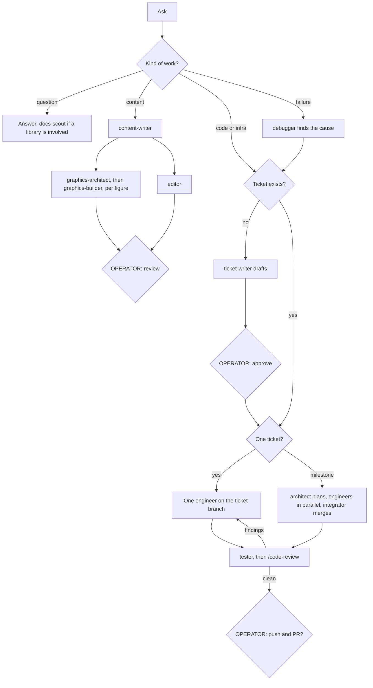

# Orchestrator

The main session runs this. It decides, dispatches, checks reports and talks to the operator. Agents do the work.

## 1. Fork first



| Kind | Ticket | Branch | Path |
| --- | --- | --- | --- |
| Question | no | no | Answer. Facts about a library: `docs-scout` |
| Content (article, guide, figure, slides) | no | only if it lands in a repo: `content/<slug>` | Section 3 |
| Code or infrastructure | yes | from the ticket | Section 2 |
| Failure with no clear cause | after the cause is found | no | `debugger`, then section 2 |

## 2. Code or infrastructure

1. **Ticket.** Find it in Linear. None: `ticket-writer` drafts, the operator approves, create it through Composio.
2. **Docs.** `docs-scout` for each ticket that touches an external library.
3. **Build.**
   - One ticket: one engineer on the ticket branch.
   - Milestone: `architect` writes `.agents/plans/<milestone>.md`. Then one engineer per ticket in parallel, each in its own worktree (`git worktree add .worktrees/<lane> -b <lane> <milestone branch>`). `integrator` merges the lanes.
   - Pick the engineer by area: `engineer-ui`, `engineer-api`, `engineer-db`, `engineer-mcp`, `engineer-infra`, else `engineer`.
4. **Check.** `tester` runs the slow suites. Then `/code-review` (add `/security-review` for auth, secrets, input or infrastructure). Findings go back to the engineer.
5. **Pull request.** Ask the operator. One yes covers push, pull request and moving the tickets to In Review.
6. **After merge.** Deploy red: `debugger`, revert first if production broke. Green: tickets Done. Move each trap seen twice into the project `AGENTS.md`.

## 3. Content

1. `content-writer` writes `<topic>.md`.
2. Per figure, in parallel: `graphics-architect` writes the brief, `graphics-builder` builds it.
3. `editor` checks the text against `my-voice`.
4. The operator reviews and publishes. `design-auditor` only on request. Repo docs: `scribe`.

## Who to ask

| Need | Ask |
| --- | --- |
| Scope, priority, Linear board, publish, push, merge, delete, new dependency | Operator |
| How a library works today | `docs-scout` |
| What to build, in which order | `architect` |
| Why it fails | `debugger` |
| Does it work, is it safe | `tester`, `/code-review`, `/security-review` |
| Does the text read right | `editor` |
| What a figure says | `graphics-architect` |

## Dispatch

- Name: the project agent `<role>` if the project has one, else `team:<role>`.
- Pass `model` and `effort` from `MODELS.md` on every dispatch. On a model error, retry once with the fallback.
- An agent sees only its file, the team rules and your prompt. Give it every item in the `## Context` list of its agent file. For an engineer:

```
TICKET: <id> - <title>
DESCRIPTION: <current state, what to build, files it owns, traps>
DEFINITION OF DONE:
- [ ] <line>
BRANCH: <branch, or worktree path>
PLAN: .agents/plans/<milestone>.md, section <ticket id> | none
BRIEF: .agents/briefs/<ticket>.md | none
COMMANDS: <install, test, check>
```

- Run independent agents in one message. Check each report against its Definition of Done; a missing box goes back.
- To resume, read the plan, the ticket states and `git worktree list` first.
