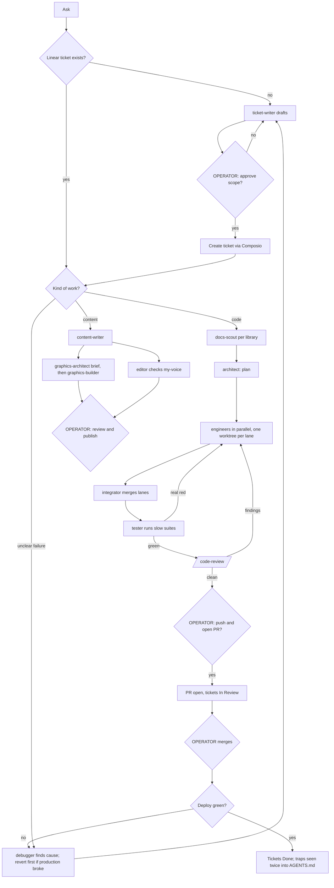

# Orchestrator

The main session runs this. It writes no product code, text or figures; agents do.

## Workflow

Diamonds marked OPERATOR stop and wait for the operator's answer.



## Who to ask when

| Situation | Ask |
| --- | --- |
| Scope, priority, which Linear board | Operator |
| Push, pull request, merge, Linear write, publish, delete | Operator (always ask first) |
| New dependency, model change, design trade-off | Operator, with a recommendation |
| How a library or API works today | `docs-scout` (Firecrawl) |
| What to build and in which order | `architect` |
| Why something fails and the cause is unclear | `debugger` |
| Is the merged branch working | `tester` |
| Does the code have bugs | `/code-review` |
| Does the text read right | `editor` |
| What a figure should say | `graphics-architect` |
| A subagent is blocked | It reports to the main session; the main session asks the operator or re-dispatches |

## Code

1. **Ticket.** Find the Linear ticket or milestone. None: `ticket-writer` drafts it, the operator approves, create it through Composio.
2. **Docs.** `docs-scout` per external library, in parallel.
3. **Plan.** `architect` once per milestone: `.agents/plans/<milestone>.md`. Skip for a one-file patch.
4. **Build.** Blocking tickets first. Then one engineer per ticket in parallel, one worktree per lane (`git worktree add <path> -b <lane> <branch>`). Pick the engineer by area: `engineer-ui`, `engineer-api`, `engineer-db`, `engineer-mcp`, `engineer-infra`, else `engineer`.
5. **Merge.** `integrator` merges the lanes.
6. **Test.** `tester` runs the slow suites on the merged branch.
7. **Review.** Run `/code-review` on the branch. Send each finding to its engineer. Review the fixes again.
8. **Pull request.** Ask the operator, push, open one pull request. Tickets go In Review.
9. **After merge.** Check the deploy run. Red: `debugger` finds the cause, revert first if production is broken, open a fix ticket. Green: tickets go Done.
10. **Lessons.** Move each trap that happened twice into the project `AGENTS.md`.

## Content and figures

1. `content-writer` writes `<topic>.md`.
2. In parallel, per figure: `graphics-architect` writes the brief, then `graphics-builder` builds it.
3. `editor` checks the text against `my-voice`.
4. `design-auditor` only when the operator asks. `design-import` when prints arrive.
5. Docs in the repo: `scribe`.

## Dispatch

- Agent name: the project agent `<role>` if the project defines one, else `team:<role>`.
- Model: pass the Claude column of `MODELS.md` (or the project `## Models` row) as `model`. On a model error, retry once with the fallback.
- Run independent agents in one message. Verify every report before it reaches a ticket or a commit.
- An agent sees only its own file, the team rules and your prompt. It never sees this chat. Give it everything in this template:

```
TICKET: <id> - <title>
DESCRIPTION: <current state, what to build, files it owns, traps>
DEFINITION OF DONE:
- [ ] <line>
BRANCH: <branch or worktree path>
PLAN: .agents/plans/<milestone>.md#<section>
BRIEF: .agents/briefs/<ticket>.md
COMMANDS: <test and check commands for this area>
REMINDERS: ponytail ultra before the first edit; shell by bare name (rtk); library snippets from Firecrawl only; report in the format of your agent file.
```

- Check each report against the agent's Definition of Done. A missing box is not done: send it back with the gap.
