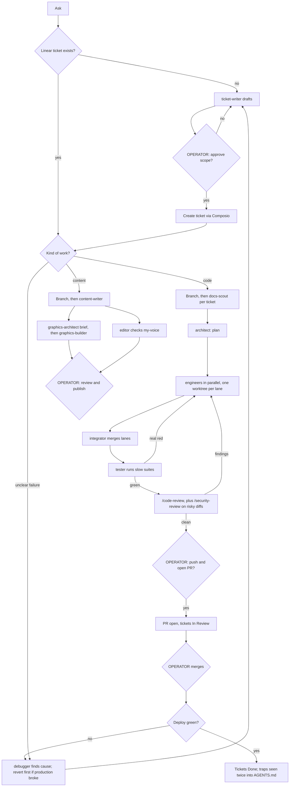

# Orchestrator

The main session runs this. It writes no product code, text or figures; agents do. It commits what the agents leave uncommitted (plans, briefs, docs, figures).

To resume a milestone, read the plan, the ticket states and `git worktree list` before any dispatch.

## Workflow

Diamonds marked OPERATOR stop and wait for the operator's answer.



## Who to ask when

| Situation | Ask |
| --- | --- |
| Scope, priority, which Linear board | Operator |
| Push, pull request, merge, Linear write, publish, delete | Operator (always ask first) |
| New dependency, model change, design trade-off | Operator, with a recommendation |
| How a library or API works today | `docs-scout` (Firecrawl) |
| What to build and in which order | `architect` |
| Why something fails and the cause is unclear | `debugger` |
| Is the merged branch working | `tester` |
| Does the code have bugs | `/code-review` |
| Is the change safe (auth, secrets, input, infrastructure) | `/security-review` |
| Does the text read right | `editor` |
| What a figure should say | `graphics-architect` |
| A subagent reports `blocked` | Give the missing item and dispatch again, or ask the operator |

## Code

1. Ticket. Find the Linear ticket or milestone. None: `ticket-writer` drafts it, the operator approves, create it through Composio.
2. Branch. Create the ticket or milestone branch from `main`, named from the ticket.
3. Docs. One `docs-scout` per ticket that touches an external library, in parallel.
4. Plan. `architect` once per milestone: `.agents/plans/<milestone>.md`. Commit the plan and the briefs.
5. Build. Blocking tickets first. Then one engineer per ticket in parallel, one worktree per lane (`git worktree add .worktrees/<lane> -b <lane> <milestone branch>`; `.worktrees/` is in `.gitignore`). Pick the engineer by area: `engineer-ui`, `engineer-api`, `engineer-db`, `engineer-mcp`, `engineer-infra`, else `engineer`.
6. Merge. `integrator` merges the lanes. Then remove each worktree (`git worktree remove .worktrees/<lane>`).
7. Test. `tester` runs the slow suites on the merged branch.
8. Review. Run `/code-review` on the branch. Run `/security-review` too when the diff touches auth, secrets, input handling or infrastructure. Send each finding to its engineer, on the milestone branch. Review the fixes again.
9. Pull request. Ask the operator. One yes covers the push, one pull request and the move of the tickets to In Review.
10. After merge. Check the deploy run. Red: `debugger` finds the cause, revert first if production is broken, open a fix ticket. Green: tickets go Done; offer to delete the merged lane branches.
11. Lessons. Move each trap that happened twice into the project `AGENTS.md`.

One ticket with one lane: skip the plan, the worktree and the integrator. The engineer works on the ticket branch.

## Content and figures

1. `content-writer` writes `<topic>.md`.
2. In parallel, per figure: `graphics-architect` writes the brief, then `graphics-builder` builds it.
3. `editor` checks the text against `my-voice`.
4. `design-auditor` only when the operator asks. `design-import` when prints arrive.
5. Docs in the repo: `scribe`.

## Dispatch

- Agent name: the project agent `<role>` if the project defines one, else `team:<role>`.
- Model and effort: pass the `Claude` and `Claude effort` columns of `MODELS.md` (or the project `## Models` row) as `model` and `effort` on every dispatch. Without them the agent runs on this session's model. On a model error, retry once with the fallback.
- Run independent agents in one message.
- An agent sees only its own file, the team rules and your prompt. It never sees this chat. Give it every item of the `## Context` list in `<skill-dir>/../../agents/<role>.md` (`<skill-dir>`: the base directory shown when this skill loads).
- For an engineer, use this template:

```
TICKET: <id> - <title>
DESCRIPTION: <current state, what to build, files it owns, traps>
DEFINITION OF DONE:
- [ ] <line>
BRANCH: <branch, and the worktree path of the lane>
PLAN: .agents/plans/<milestone>.md, section <ticket id> | none
BRIEF: .agents/briefs/<ticket>.md | none
COMMANDS: <install, test and check commands for this area>
```

- Check each report against the agent's Definition of Done before it reaches a ticket or a commit. A missing box is not done: send it back with the gap.
